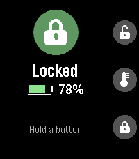
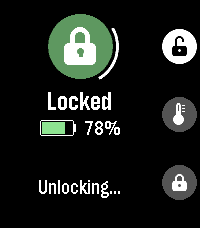
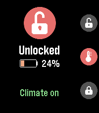
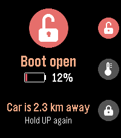
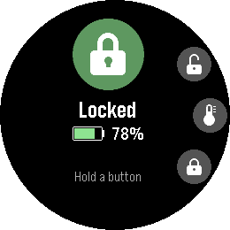
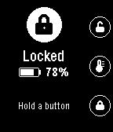

# PebbleKey for Volvo

Lock, unlock and pre-heat a Volvo from a Pebble watch.

<p>




</p>

*Pebble Time 2: locked; unlocking; unlocked with climate on; boot open and too far away to
unlock without a second hold.*

<p>


</p>

*Pebble Round 2, and a black-and-white Pebble 2.*

PebbleKey for Volvo (PebbleKey for short) is a Pebble watchapp that talks to Volvo's
[Connected Vehicle API](https://developer.volvocars.com/apis/connected-vehicle/v2/overview/).
There is no extra phone app: the phone half is JavaScript that runs inside the official Pebble
app, and it sends commands straight to Volvo.

| Button | Action |
| --- | --- |
| Hold UP | Unlock (asks for a second hold if the phone is not near the car) |
| Hold SELECT (middle) | Climate on, or off if PebbleKey turned it on |
| Hold DOWN | Lock |

The icons on the right sit next to the buttons they belong to. The rest of the screen shows
what the car last reported:

- **Badge:** green with a closed padlock when the car is locked, orange with an open one when it
  is unlocked, grey until the car's state is known.
- **Under the badge:** "Locked" or "Unlocked", or what is open ("Boot open"), and the battery
  level.
- **Bottom:** what PebbleKey is doing, the result, or the reason something failed.

> **Status:** a personal project built for a Volvo EX30. It is young and lightly tested. Other
> Volvo models that support the Connected Vehicle API should work but have not been tried.
> It is not affiliated with Volvo Cars or with Pebble / Core Devices. It can unlock your car:
> use it at your own risk.

## Two ways to set it up

| | Sign in with Volvo | Your own Volvo keys |
| --- | --- | --- |
| What you do | Tap a button on your phone and sign in with your Volvo ID | Create a Volvo developer application and run a login script on a computer |
| Needs | A build that names a sign-in service (someone has to [run one](#running-a-sign-in-service)) | A free account at [developer.volvocars.com](https://developer.volvocars.com/) |
| Who you trust | Volvo, and whoever runs the sign-in service | Volvo only |

A build has "Sign in with Volvo" when [src/pkjs/broker.json](src/pkjs/broker.json) names a
service. This repository and its ready-made build name the one run by the project's author. To
use your own service, or none, see [Running a sign-in service](#running-a-sign-in-service).

Either way you need a Pebble watch paired with the current Pebble phone app (all models, from
the original Pebble to Pebble 2 Duo, Pebble Time 2 and Pebble Round 2) and a Volvo with an
active Volvo ID and remote services.

## Build and install

**Ready-made build:** [dist/PebbleKey.pbw](dist/PebbleKey.pbw) is the watchapp built from this
repository. Download it on your phone and open it with the Pebble app. Both setup routes work
with it; skip to [installing](#install-on-the-watch) if you use it.

To build it yourself you need Python 3.8+, Node.js and [uv](https://docs.astral.sh/uv/).

```bash
uv tool install --python 3.13 pebble-tool
```

```bash
pebble sdk install latest
```

```bash
npm install
```

```bash
pebble build
```

The result is a `.pbw` file in `build/`.

### Install on the watch

Either send the `.pbw` file to your phone and open it with the Pebble app, or install over the
developer connection:

1. In the Pebble phone app: **Settings > Phone > Connectivity**, turn on
   **Use LAN developer connection**.
2. **Devices** tab, three-dot menu on your connected watch, turn **Dev Connection** on (off and
   on again if it already was).
3. With the phone awake and the IP address shown under that switch:

```bash
pebble install --phone <phone-ip>
```

The LAN developer connection has no authentication. Use it on a network you trust and switch it
off afterwards.

The Pebble phone app will ask you to allow PebbleKey:

- **Internet access**, to reach Volvo (and the sign-in service, if the build has one)
- **Location**, only for the distance check before unlocking

## Set up: Sign in with Volvo

**[Step-by-step guide with screenshots](docs/SETUP.md)**, starting from installing the app. In
short:

1. Open PebbleKey on the watch and leave it open.
2. In the Pebble phone app open PebbleKey's settings and tap **Sign in with Volvo**. Your
   browser opens.
3. Continue to Volvo, tick **Remember me**, sign in and approve the access PebbleKey asks for.
4. Tap **Finish in the Pebble app** (or pick your car, if you have several). The watch buzzes
   and shows "Setup saved".

If the last tap does nothing, copy the code shown below the button and paste it into
**Setup code** in PebbleKey's settings.

## Set up: your own Volvo keys

### 1. Create a Volvo API application

1. Sign in at [developer.volvocars.com](https://developer.volvocars.com/), open your account
   page and create an application. It gets a **VCC API key** straight away.
2. Click **Publish** on the application. This is where you choose scopes and the redirect URI,
   and where you get the **client ID** and **client secret**.
3. Redirect URI: `http://localhost:8765/callback`
4. Scopes: tick all of these now. I found no way to add one later short of creating a new
   application.

| Scope | Used for |
| --- | --- |
| `conve:lock` | Lock (required) |
| `conve:unlock` | Unlock (required) |
| `conve:climatization_start_stop` | Climate on/off |
| `conve:lock_status`, `conve:doors_status` | Lock state and open doors on the watch |
| `conve:fuel_status`, `conve:battery_charge_level` | Battery level on the watch |
| `location:read` | Distance check before unlocking |

Only lock and unlock are required. Anything you leave out is simply missing in the app.

### 2. Log in once on your computer

```bash
python3 tools/volvo_login.py
```

The script asks for the client ID, client secret, VCC API key (the primary one) and your car's
17-character VIN, then opens the Volvo ID sign-in in your browser. Tick **Remember me** there.

It checks which scopes your application has, requests only those, and prints a **setup code**
starting with `EX30K1.`. The code contains your client secret and login, so treat it like a
password.

Your answers are saved in `tools/.volvo.json`, which is git-ignored and readable only by you.
Use `--reconfigure` to enter them again, for example after creating a new Volvo application.

### 3. Paste the setup code

In the Pebble phone app open PebbleKey's settings, paste the setup code and save. The watch
shows "Setup saved" and, a moment later, the car's status.

## Quick launch (optional)

Quick Launch opens PebbleKey when you hold a button on the watchface, so the car is two holds
away: one to open the app, one to lock or unlock.

- **In the Pebble phone app:** **Settings > Watch > Quick Launch**, pick a button and choose
  PebbleKey.
- **Or on the watch:** **Settings > Quick Launch**.

Opening the app never does anything by itself: release the button, then hold UP, SELECT or DOWN.

## How it behaves

**Unlock safety.** Before unlocking, the phone compares its position with where the car is
parked. Within 200 m the unlock goes straight through. Further away, or when either position
is unknown, the watch shows why and unlocks only if you hold UP again within 15 seconds. The
range (100 m, 200 m, 500 m or off) is in the settings. Lock and climate work from anywhere.

**Climate.** Volvo's API cannot report whether climate is running, so the middle button goes by
what PebbleKey last did: it stops climate if PebbleKey started it in the last 30 minutes,
otherwise it starts it. The thermometer icon is lit while PebbleKey believes climate is on. If
you switched climate from the Volvo app or the car in between, the first hold may do nothing
visible; hold again.

**Car state.** Read when the app opens and again a few seconds after a lock or unlock. It is
what the car last told Volvo, so it can lag behind the car.

**Feedback.** A command takes a few seconds; a ring turns around the badge and the button's
icon lights up meanwhile. The watch buzzes once on success and twice on failure, with the
reason on screen.

**Login lifetime.** Volvo limits a login to 3 months. When the watch says the login expired,
sign in again (or run the login script again and paste the new code). Volvo also replaces the
login token every time it is used, so a setup code stops working once the watch has sent its
first command.

## Messages on the watch

| Message | Meaning |
| --- | --- |
| Set up in Pebble app | Not signed in and no setup code entered yet |
| Allow internet in Pebble app | The Pebble phone app is blocking PebbleKey's internet access |
| No internet on phone | The phone could not reach Volvo or the sign-in service |
| Login expired, sign in again | Tap Sign in with Volvo in the settings again |
| Login expired, redo setup | Own keys: run the login script again and paste the new code |
| Sign-in service error 502 | The sign-in service could not renew your login; try again later |
| This build has no sign-in | The setup code came from a sign-in service this build does not use |
| Not allowed (scopes?) | The Volvo application lacks the scope for this action |
| Car is asleep / Car is offline | The car did not take the command; try again shortly |
| A door is open | The car refused to lock |
| Car is 2.3 km away | Distance check: hold UP again to unlock anyway |
| No car location / No phone location | Distance check could not run; hold UP again to unlock anyway |
| No reply from phone | The watch lost its connection to the phone |

## Running a sign-in service

This is for whoever wants to offer "Sign in with Volvo" to other people: one Volvo application
of yours, which each user signs in to with their own Volvo ID. Volvo requires the application's
client secret for every sign-in and every login renewal, and a secret cannot ship inside a
public watchapp, so those two calls go through a small service you host. [broker/](broker/) is
that service, written for a free [Cloudflare Workers](https://workers.cloudflare.com/) account.

What it handles: the sign-in, and renewing each user's login (every few minutes while they use
the app). It stores nothing, but login tokens pass through it, so your users are trusting you.
Lock, unlock, climate, status and location go from the phone straight to Volvo.

1. Deploy it. The first command signs you in to Cloudflare; the second prints the service's
   address, such as `https://pebblekey.<your-name>.workers.dev`.

```bash
cd broker && npx wrangler login
```

```bash
cd broker && npx wrangler deploy
```

2. Create and **Publish** a Volvo application as in
   [step 1 of the own-keys route](#1-create-a-volvo-api-application), with two differences:
   the redirect URI is your service's address followed by `/callback`, and you also tick
   `conve:vehicle_relation` (used to list the user's cars). Tick every scope in the table; if
   one is missing, Volvo rejects every sign-in until you list your scopes in `VOLVO_SCOPES`
   (see [broker/wrangler.toml](broker/wrangler.toml)).
3. Give the service its three keys. Each command asks you to paste one value.

```bash
cd broker && npx wrangler secret put VOLVO_CLIENT_ID
```

```bash
cd broker && npx wrangler secret put VOLVO_CLIENT_SECRET
```

```bash
cd broker && npx wrangler secret put VOLVO_API_KEY
```

4. Point the watchapp at it and rebuild. Everyone who installs this build gets the
   Sign in with Volvo button. (`python3 tools/set_broker.py --none` makes a build without it.)

```bash
python3 tools/set_broker.py https://pebblekey.<your-name>.workers.dev
```

```bash
pebble build
```

Things to know before you offer it to others:

- Volvo allows an application 10,000 API calls a day, shared by all its users. Opening the app
  costs about three calls, and a lock or unlock about three more.
- The VCC API key is handed to each signed-in phone. If you replace it in Volvo's portal, put
  the new one in `VOLVO_API_KEY`; phones pick it up the next time they renew their login.
- You are bound by Volvo's
  [developer terms](https://developer.volvocars.com/terms-and-conditions/), which include data
  protection duties towards your users.
- Anyone who obtains your client secret can pose as your application on Volvo's sign-in page.
  Keep it only in the Cloudflare secret.

## Security notes

- Anyone holding your unlocked watch while it is connected to your phone can unlock your car.
- Your login token is stored in the Pebble phone app's storage for this watchapp, on your phone
  only. With your own keys, the client secret is stored there too.
- A setup code and `tools/.volvo.json` hold the same secrets. Do not share or commit them.

## Development

```bash
node --test
```

runs the tests for the phone-side code and the sign-in service against a fake Volvo; no car or
account needed.

| Path | Contents |
| --- | --- |
| `src/c/main.c` | Watch UI and buttons |
| `src/pkjs/volvo.js` | Token refresh and Volvo API calls |
| `src/pkjs/proximity.js` | Distance check between phone and car |
| `src/pkjs/index.js` | Glue between watch, settings page and the two modules above |
| `src/pkjs/config.json`, `custom-clay.js` | Settings page ([Clay](https://github.com/pebble/clay)) |
| `src/pkjs/broker.json` | Address of the sign-in service this build uses, if any |
| `broker/` | The sign-in service (Cloudflare Worker) |
| `tools/volvo_login.py` | One-time Volvo ID login for the own-keys route |
| `tools/set_broker.py` | Sets the sign-in service address in the two places that need it |
| `tools/make_dist.sh` | Builds and refreshes `dist/PebbleKey.pbw`, the ready-made build |
| `test/`, `broker/test/` | Tests |
| `docs/SETUP.md` | Step-by-step setup guide for the sign-in route |

## Licence

[MIT](LICENSE)
