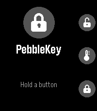
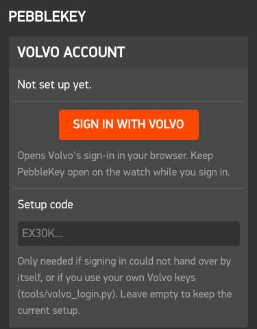
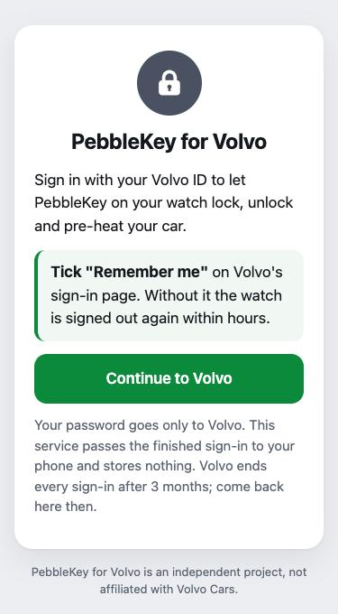
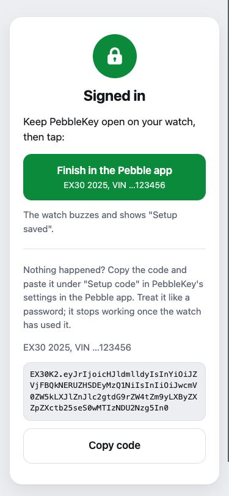
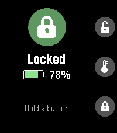
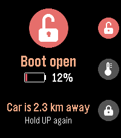

# Setting up PebbleKey for Volvo, step by step

This guide takes you from nothing to locking your car from your wrist. It takes about five
minutes and needs only your phone and your watch.

You need:

- a Pebble watch, paired with the Pebble app on your phone
- a Volvo with remote services, and the Volvo ID (email and password) you use in the Volvo
  Cars app

If you would rather use your own Volvo developer keys than sign in through the PebbleKey
sign-in service, follow [the own-keys route](../README.md#set-up-your-own-volvo-keys) instead.

## 1. Install PebbleKey on the watch

On your phone, open
[PebbleKey for Volvo in the Pebble Appstore](https://apps.repebble.com/17029805a6d84b6295f32a36)
and install it from there. The Pebble app installs it on your watch and keeps it up to date.

Without the store: download
[PebbleKey.pbw](https://github.com/alarmatwork/PebbleKey/raw/main/dist/PebbleKey.pbw) and open
the downloaded file with the Pebble app. That copy does not update itself.

The Pebble app asks you to allow two things for PebbleKey:

- **Internet access**, to reach Volvo and the sign-in service
- **Location**, used only to check that you are near the car before unlocking

## 2. Open PebbleKey on the watch

Find PebbleKey in the watch's app menu (the name is shortened there) and open it. Until it is set up, the badge is grey.

**Leave it open** for the following steps. The watch receives the finished sign-in only while
PebbleKey is on screen.

## 3. Tap "Sign in with Volvo" in the Pebble app

In the Pebble app on your phone, find PebbleKey among your apps and open its **settings**. Tap
**Sign in with Volvo**. The Pebble app asks whether to open the link; say yes, and your browser
opens.

## 4. Continue to Volvo

The browser shows PebbleKey's sign-in page. Tap **Continue to Volvo**.

## 5. Sign in with your Volvo ID

You are now on Volvo's own page, at `volvocars.com`. Your password goes only to Volvo.

1. Enter your Volvo ID email and password.
2. Tick **Remember me**. Without it the watch is signed out again within hours.
3. Approve the access PebbleKey asks for: locking and unlocking, climate, and reading the car's
   lock state, battery level, charging and position.

## 6. Finish in the Pebble app

Back on PebbleKey's page, tap **Finish in the Pebble app**. If your Volvo ID has several cars,
there is one button per car: tap the one you want on the watch.

The watch buzzes and shows "Setup saved". The Pebble app comes to the front, still showing
PebbleKey's settings; it shows nothing new, so look at the watch.

**If the watch stays quiet:** the Pebble app passes the sign-in on only while PebbleKey is open
on the watch. Open PebbleKey on the watch, switch back to the browser page and tap the button
again.

**If that does not help either:** tap **Copy code** further down that page, go back to
PebbleKey's settings in the Pebble app, paste the code into **Setup code** and save. The code
works once and is as sensitive as a password, so do not share it.

## 7. Done

A moment later the watch shows your car: a green badge when it is locked, an orange one when it
is unlocked, and the battery level.

Every action needs a **hold** of about a second, so that a bump cannot unlock your car:

| Button | Action |
| --- | --- |
| Hold UP | Unlock |
| Hold SELECT (middle) | Climate on or off |
| Hold DOWN | Lock |

If your phone is more than 200 m from the car when you unlock, the watch tells you how far away
the car is and waits for a second hold of UP. You can change that distance, or switch the check
off, in PebbleKey's settings.

## 8. Optional: open it with one long press

Quick Launch opens PebbleKey when you hold a button on the watchface, so you do not have to go
through the app menu.

In the Pebble app on your phone, open **Settings > Watch > Quick Launch**, pick the button you
want and choose PebbleKey. The same setting is on the watch itself, under
**Settings > Quick Launch**.

Holding that button only opens PebbleKey. Nothing is sent to the car until you release it and
hold UP, SELECT or DOWN.

## Later on

- **"Login expired, sign in again":** Volvo ends every sign-in after 3 months. Repeat steps 2
  to 6.
- **A different car, or a new phone:** repeat steps 2 to 6.
- **Stop using PebbleKey:** remove it in the Pebble app. The sign-in it held ends by itself,
  at the latest 3 months after you made it.

More on what the messages on the watch mean is in the
[README](../README.md#messages-on-the-watch).
